# renewcast: hourly solar and wind forecasting for Germany


Predicts the hourly national output of **solar** and **wind** (onshore + offshore) power in Germany
from gridded weather data. A convolutional neural network looks at one weather map per hour,
radiation for solar and wind speed for wind, taken from the German Weather Service (DWD) HOSTRADA
data set, and regresses the generation reported by the transmission system operators.

This repository turns an exploratory Kaggle notebook into a configurable, tested pipeline:
download, clean, align, train, evaluate and report from a single command line.

> **Status.** The pipeline code, configs and tests are complete. It has been verified on synthetic
> data (including a tiny end-to-end train and evaluate run), and its data-cleaning step has been
> run read-only against the real generation CSV. **A full run on the real HOSTRADA data has not
> been performed yet**; the results below come from the original notebook and from re-scoring its
> saved predictions, not from this pipeline.

## Results

Two kinds of numbers exist for the original notebook, and they tell different stories. The first is
what the notebook reported. The second is what its saved 2024 forecasts actually score.

| Target | Notebook, shuffled 2023 hold-out (R²) | Saved 2024 forecast, as evaluated (R²) | Same forecast, UTC-aligned (R²) |
|---|---|---|---|
| Solar | 0.977 | 0.854 | **0.931** |
| Wind | 0.956 | 0.841 | **0.845** |

* The first column is a random 10% of 2023 hours held out, so neighbouring hours leak between
  training and validation. It is an interpolation score, not a forecast score.
* The second and third columns score the notebook's own 2024 predictions (7,294 and 7,295 hours,
  January to 30 October 2024) with [`scripts/rescore_saved_predictions.py`](scripts/rescore_saved_predictions.py).
  The only difference between them is that the third converts the observed generation from German
  local time to UTC before matching it with the (UTC) weather frames.
* Full table with MAE and RMSE, and every finding with its evidence:
  [`docs/notebook_audit.md`](docs/notebook_audit.md).

| 2024 forecast (UTC-aligned) | Solar | Wind |
|---|---|---|
| MAE | 1,855 MW | 3,160 MW |
| RMSE | 3,074 MW | 4,172 MW |
| MAE / mean observed | 22% | 21% |

The pipeline in this repo fixes the issues behind the gap (see [Differences from the
notebook](#differences-from-the-notebook)). Expect honest 2024 scores from it, not 0.97.

## Figures from the notebook

All figures were extracted from the outputs stored in the notebook, without re-running it
(`scripts/extract_notebook_assets.py`).

### Data exploration

<table>
<tr>
<td width="38%">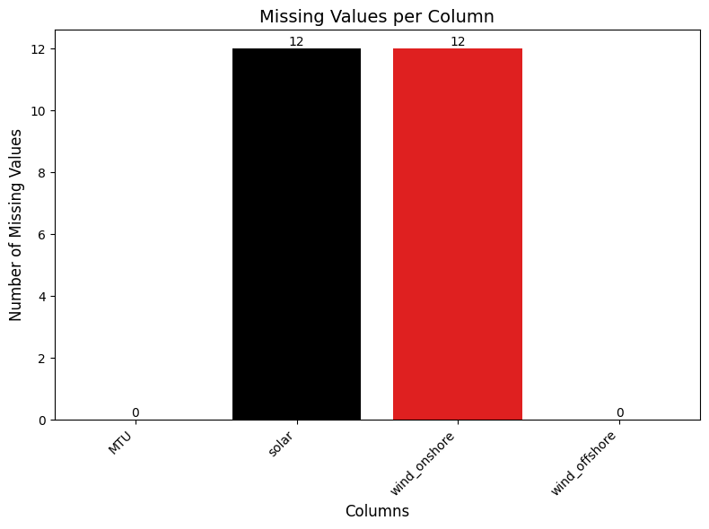</td>
<td>

**Missing values.** After filtering to 2023-2024, `solar` and `wind_onshore` each have 12 missing
15-minute readings; `wind_offshore` has none. They are imputed before the data is aggregated to hours.

</td>
</tr>
</table>

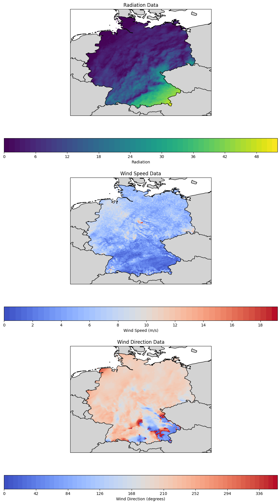

**Weather inputs.** One hour (2 January 2023, 08:00 UTC) of the three HOSTRADA fields: downwelling
radiation (strongest in the south), wind speed (0 to about 19 m/s) and wind direction (0 to 360°).
The CNN receives one such 469 x 360 map per hour. Wind direction is plotted but is not used as a
model input.

### Solar power model

| Training history | Validation, full hold-out | Validation, first 150 hours |
|---|---|---|
| 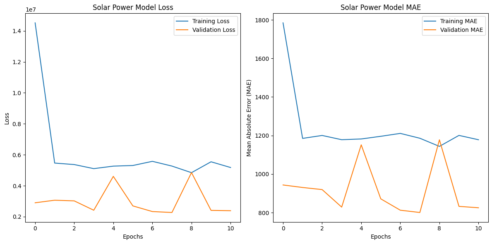 | 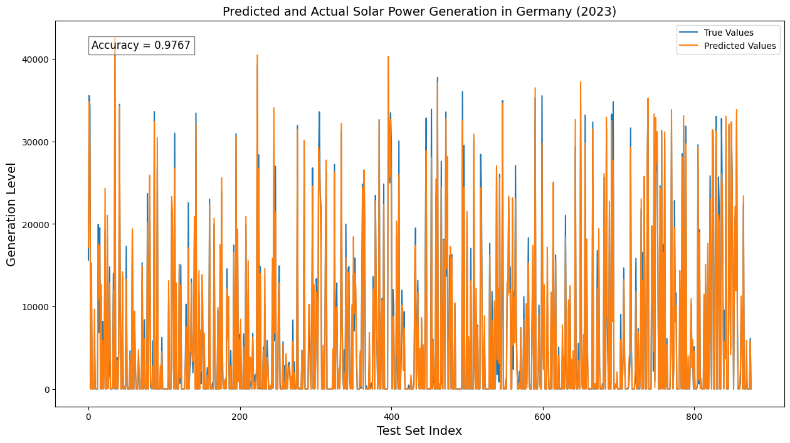 | 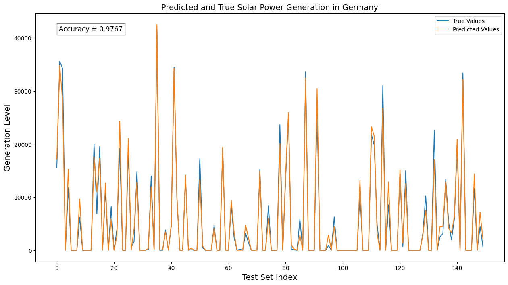 |

Early stopping ended training after 11 of 15 epochs and restored the weights from epoch 8
(validation MAE 801 MW, R² 0.9767 on the 876 shuffled hold-out hours). Loss and MAE are in raw MW
units, hence the 10^7 scale.

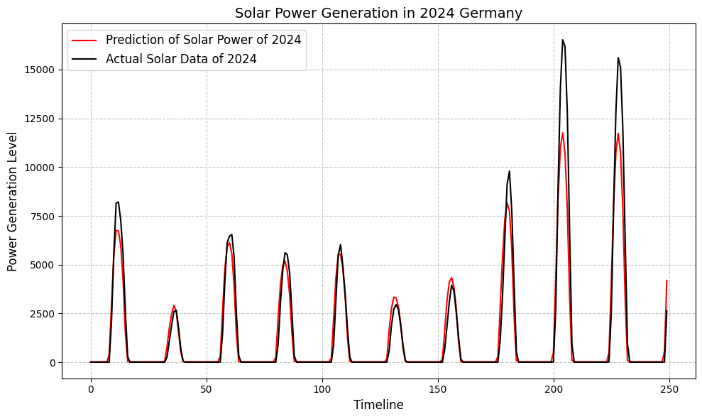

**2024 forecast.** The model reproduces the daily cycle, but the highest peaks in the first ten days of
January are under-predicted (for example about 11.7 GW predicted against 16.5 GW observed).

### Wind power model

| Training history | Validation, full hold-out | Validation, first 150 hours |
|---|---|---|
| 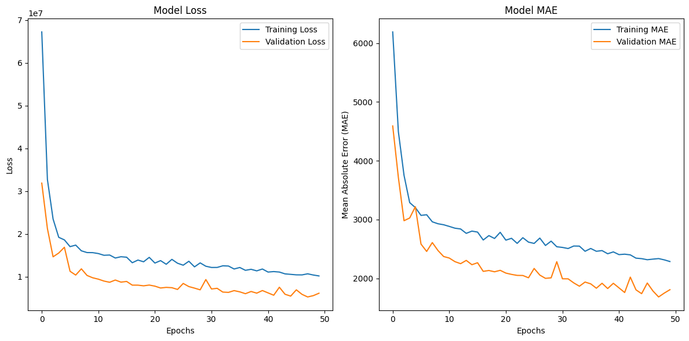 | 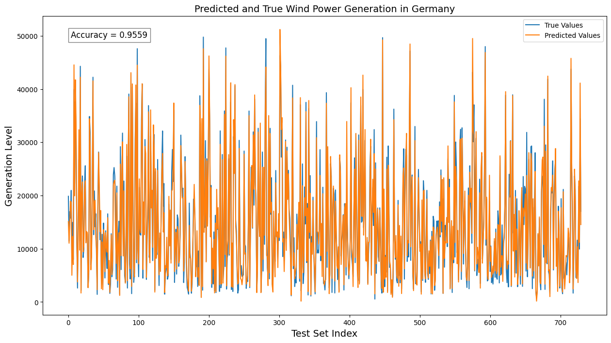 | 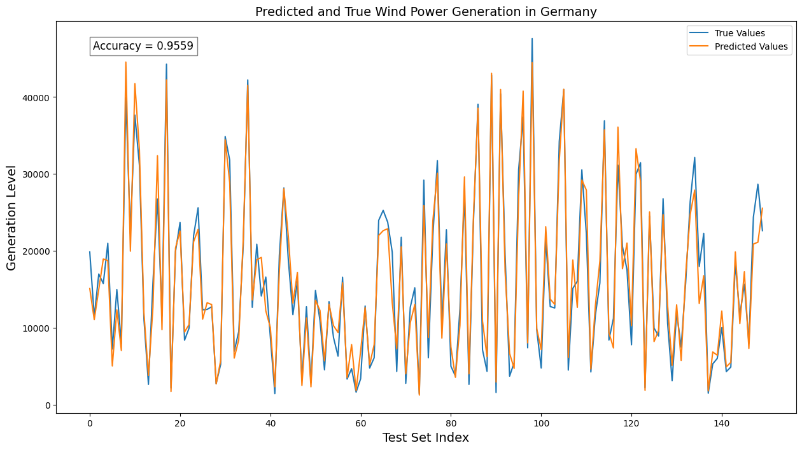 |

All 50 epochs ran without early stopping; validation MAE ended at 1,686 MW with R² 0.9559 on the 730
shuffled hold-out hours. The curves were still improving slowly.

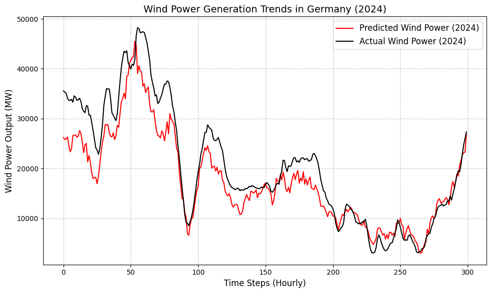

**2024 forecast.** The shape of the multi-day wind events is captured, with a level error of up to
about 9 GW in the first two days of the year.

## How it works

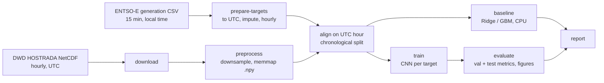

1. **prepare-targets** converts German local time to UTC (resolving the repeated October hour),
   imputes missing values, aggregates quarter-hours to hours and sums onshore and offshore wind.
2. **download / preprocess** fetch monthly NetCDF files and stream them into memory-mapped
   `float32` arrays on disk, so memory use does not grow with the number of years.
3. **Alignment and splitting** inner-joins weather frames and targets on the UTC hour. Training is
   2023, test is 2024; validation is held out as whole weeks of 2023 with a 24 h buffer.
4. **train** fits scalers on training hours only, trains with early stopping, and stores the model,
   scalers, split times and a copy of the configuration in a self-contained run directory.
5. **evaluate / report** score validation and test hours in MW (R², MAE, RMSE, bias, normalised
   errors, per-month metrics) and write forecast, scatter, daily-mean and error-by-hour figures.
6. **baseline** fits Ridge and gradient boosting on spatial summary statistics of each weather map
   plus calendar features. It runs on a CPU and tells you whether the CNN is learning anything that
   simple features do not already give.

### Models

| Architecture | Layers | Parameters (469 x 360 input) |
|---|---|---|
| `baseline` (the notebook's CNN) | 2 x (Conv + MaxPool), Flatten, Dense 128, Dropout 0.5, Dense 1 | 82.9 M |
| `compact` | Conv-BatchNorm-ReLU-Pool blocks, strided Conv, Flatten, Dropout, Dense | 2.9 M with `filters: [16, 32, 64, 128]` |

Almost all of the baseline's 82.9 M parameters sit in the first dense layer (647,680 x 128). The
`compact` variant exists for GPUs with little memory and as a stronger regularised alternative.

## Project structure

```
.
├── configs/
│   ├── default.yaml              # improved defaults
│   ├── notebook_replica.yaml     # shuffled split, instant values, raw-MW target (closest to the notebook)
│   └── smoke_test.yaml           # tiny model, coarse grid, few hours: validates a new machine
├── src/renewcast/
│   ├── cli.py, pipeline.py       # command line and stage orchestration
│   ├── config.py                 # typed, validated YAML configuration
│   ├── data/                     # download, generation, weather, prepare, splits, scaling, dataset
│   ├── models/                   # cnn.py (Keras), baseline.py (scikit-learn)
│   ├── training/train.py
│   ├── evaluation/               # metrics, evaluate, report
│   └── visualization/            # eda.py, plots.py
├── scripts/
│   ├── extract_notebook_assets.py      # figures + metrics from the stored notebook outputs
│   └── rescore_saved_predictions.py    # scores the notebook's saved 2024 forecasts
├── tests/                        # pytest, synthetic data only
├── notebooks/                    # the original exploratory notebook, unchanged
├── docs/                         # notebook audit, extracted figures and metrics
├── data/README.md                # data sources and expected layout
├── Makefile  Dockerfile  pyproject.toml  .pre-commit-config.yaml  .github/workflows/ci.yml
```

## Getting started

### 1. Install

```bash
python -m venv .venv && source .venv/bin/activate
pip install -e ".[dev]"          # data preparation, baselines, tests (CPU only)
pip install -e ".[tf,viz]"       # add TensorFlow/Keras for training, cartopy for map plots
renewcast check-env              # versions and visible GPUs
```

Use Python 3.10 to 3.12 (what current TensorFlow releases support).

### 2. Get the data

Place the ENTSO-E generation CSV at
`data/raw/generation/20200101-20241030-gen_per_prod_type.csv`. Details in
[`data/README.md`](data/README.md).

### 3. Run

```bash
renewcast download --dry-run     # check the file list before downloading ~10 GB
renewcast run-all                # download -> targets -> preprocess -> eda -> baseline -> train -> evaluate -> report
```

Or stage by stage:

```bash
renewcast download
renewcast prepare-targets
renewcast preprocess
renewcast baseline               # CPU only
renewcast train -t solar         # GPU strongly recommended
renewcast evaluate -t solar      # latest run; use --run <id> for another
renewcast report
```

Validate a new machine first with the smoke configuration (small grid, 2 epochs):

```bash
renewcast run-all -c configs/smoke_test.yaml --skip eda
```

`make help` lists the same commands as make targets.

### Where results go

| Path | Content |
|---|---|
| `data/interim/targets_hourly.csv` | cleaned hourly UTC targets |
| `data/processed/weather/<var>.npy` | memory-mapped weather cubes |
| `artifacts/runs/<target>/<run_id>/` | model, scalers, config snapshot, metrics, predictions, figures |
| `artifacts/baselines/<target>/` | baseline metrics and predictions |
| `reports/metrics_summary.md`, `reports/figures/` | latest results collected by `report` |

## Configuration

Everything is controlled by YAML. Unknown keys are rejected. Override any value from the command
line, and derive a config from another with `extends:`.

```bash
renewcast train -t wind --set targets.wind.training.epochs=20 --set targets.wind.model.architecture=compact
renewcast show-config            # print the fully resolved configuration
```

Useful switches:

| Setting | Options | Effect |
|---|---|---|
| `split.val_strategy` | `blocked` (default), `tail`, `random` | how validation hours are chosen |
| `generation.hourly_aggregation` | `mean`, `instant` | quarter-hours to hours |
| `generation.imputation` | `interpolate`, `iterative`, `none` | fill missing readings |
| `targets.*.scaling.input` | `pixel_minmax`, `global_minmax`, `global_standard` | weather scaling |
| `targets.*.model.architecture` | `baseline`, `compact` | network |
| `targets.*.training.mixed_precision` | `true` / `false` | float16 compute on supporting GPUs |
| `weather.downsample_factor` | integer | spatial stride (2 gives 469 x 360) |

To compare with the notebook as closely as possible: `renewcast train -c configs/notebook_replica.yaml`.

## Hardware and memory

The notebook states it needs 32 GB of RAM (64 GB used) and a GPU because it holds every array in
memory. The pipeline instead reads batches from disk-backed memory maps:

* **Preprocessing** streams 48 hours at a time; peak memory is a few hundred MB. Disk use is about
  6 GB per variable per year at the default grid.
* **Training** reads batches on demand. RAM use is dominated by the model and a few batches, but
  the 82.9 M-parameter baseline CNN still needs a GPU in practice. The `compact` architecture and
  `weather.downsample_factor: 4` or more reduce this considerably.
* **Baselines** and all data preparation run on a CPU.

Nothing here has been timed on real data; treat these as design properties, not benchmarks.

## Differences from the notebook

| Topic | Notebook | Pipeline default | Why |
|---|---|---|---|
| Time zones | local-time generation matched to UTC weather as text | local time converted to UTC | saved 2024 solar forecast scores R² 0.854 vs **0.931** once aligned |
| Quarter-hours to hours | value stamped on the hour | mean of the four values (`instant` available) | uses all readings |
| Missing values | `IterativeImputer` across columns | time interpolation (`iterative` available) | 24 gaps in a time series |
| Validation split | shuffled hours | whole weeks, 24 h buffer (`random` available) | avoids near-duplicate hours across the split |
| Scaler | per-pixel min-max, refitted on the 2024 inputs | fitted on training hours only, saved with the run | same transform in training and inference |
| Target | raw MW (loss about 10^7) | standardised, inverted for metrics | stable optimisation |
| Output | unconstrained (≈24 MW at night) | clipped at zero | generation is non-negative |
| Memory | everything in RAM | memory-mapped arrays | runs without 32-64 GB RAM |
| Scoring | R² on the validation split | validation and 2024 test: R², MAE, RMSE, bias, per-month, per-hour | measures forecasting, not interpolation |
| Reproducibility | none recorded | seeds, config snapshot and metadata in each run | repeatable experiments |
| Model file | `.h5` | `.keras` | current Keras format |

## Limitations and next steps

* **Not yet run on the real weather data.** First step: `renewcast run-all -c configs/smoke_test.yaml`
  and `renewcast download --dry-run`. The DWD directory names for radiation and wind speed
  (`radiation_downwelling`, `wind_speed`) follow the DWD naming scheme but only `wind_direction` was
  confirmed by the notebook; adjust `weather.variables.*.directory` if the index differs.
* One weather frame predicts one hour: no lagged frames, no time of day or season, no installed
  capacity. Capacity growth between 2023 and 2024 likely contributes to under-predicted peaks.
* The wind model in the notebook was trained on January to October 2023 only. Check the aligned
  hour counts logged by `train`.
* Wind direction is not used. It needs sin/cos encoding to be a valid input channel.
* Weather covers Germany; confirm the generation series covers the same area.
* Ideas: multi-channel inputs (radiation + cloud + temperature), temporal stacks of frames, a
  capacity-normalised target, uncertainty estimates, experiment tracking.

## Development

```bash
make lint          # ruff check + format --check on src, tests, scripts
make test          # CPU tests on synthetic data
make test-keras    # tiny end-to-end train + evaluate (needs a Keras 3 backend)
pre-commit install
```

CI runs lint and tests on Python 3.10-3.12, plus the Keras end-to-end test on a CPU backend.
The Dockerfile targets TensorFlow GPU images and has not been built yet.

The original notebook is kept untouched; linters and pre-commit hooks exclude `*.ipynb`.

## Data and acknowledgements

* Generation: ENTSO-E Transparency Platform, actual generation per production type.
* Weather: Deutscher Wetterdienst (DWD) Climate Data Center, HOSTRADA hourly grids,
  <https://opendata.dwd.de/climate_environment/CDC/grids_germany/hourly/hostrada/>. Check DWD's terms
  of use before redistributing derived data.

## License

No license file has been added yet. Add one (for example MIT) before publishing if you want others
to be able to reuse the code.
